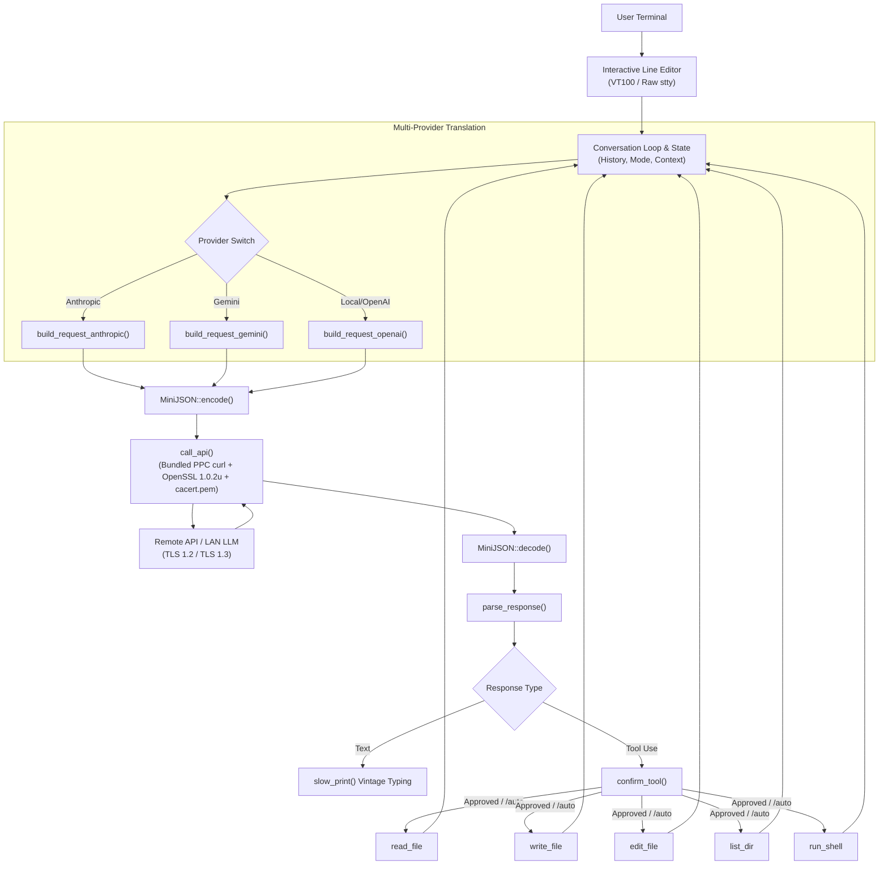

# Code Agent

<p align="center">
  <pre>
   _____          _         ___                    _   
  / ____|        | |       / _ \                  | |  
 | |     ___   __| | ___  / /_\ \ __ _  ___ _ __  | |_ 
 | |    / _ \ / _` |/ _ \ |  _  |/ _` |/ _ \ '_ \ | __|
 | |___| (_) | (_| |  __/ | | | | (_| |  __/ | | || |_ 
  \_____\___/ \__,_|\___| \_| |_/\__, |\___|_| |_| \__|
                                  __/ |                
                                 |___/                 
  </pre>
  <b>Code AI Agent for Vintage PowerPC Macs (Mac OS X 10.4 Tiger)</b>
  <br>
  <i>Autonomous terminal coding agent powered by Claude, Gemini, and Local LLMs for your vintage iBook, PowerBook, iMac, and Power Mac.</i>
</p>

<p align="center">
  
  
  
  
  
  
</p>

---

## 📖 Overview

**Code Agent** is a self-contained, interactive terminal AI agent created specifically for vintage PowerPC Macintosh computers running **Mac OS X 10.4 Tiger**.

Vintage Macs are wonderful pieces of industrial design and distraction-free computing, but browsing the modern web and interfacing with cloud services is notoriously difficult. Mac OS X 10.4's bundled OpenSSL and `curl` only support SSLv3 and TLS 1.0, making it impossible to connect to modern HTTPS APIs. Furthermore, running modern language toolchains (Python 3, Node.js, Rust, or modern Perl) on Tiger requires hours of complex compilation or broken package managers.

**Code Agent solves this completely:**
- **Zero CPAN Dependencies**: 100% pure Perl standard library that runs out of the box on stock **Perl 5.8.6** in OS X 10.4.
- **Embedded `MiniJSON` Engine**: Built-in recursive-descent JSON parser and encoder; no external modules required.
- **Bundled Modern TLS `curl`**: Includes a prebuilt, statically-linked PowerPC `curl` binary with OpenSSL 1.0.2u supporting **TLS 1.2 & TLS 1.3**, alongside a current Mozilla `cacert.pem` root certificate bundle.
- **Multi-Provider AI**: Connects to **Anthropic Claude**, **Google Gemini** (with a free tier requiring no credit card), or **Local OpenAI-compatible models** (Ollama, llama.cpp, LocalAI running on your home LAN).
- **Agentic Tool Execution**: Autonomously inspects directories, reads files, writes code, and executes shell commands directly on your Mac.
- **Safety Modes**: Switch between **Manual Mode** (`/manual`, requiring user confirmation for disk writes and commands) and **Autonomous Mode** (`/auto`, executing tools automatically).
- **Session Management**: Start a fresh conversation at any time with `/new` to reset context history without restarting the agent or re-authenticating.
- **Retro Vintage Terminal UX**: Built-in VT100 line editor with history navigation, arrow keys, and a nostalgic typewriter typing effect (`slow_print`).

---

## ⚡ Quick Start (2 Minutes)

No Xcode, MacPorts, Homebrew, or CPAN setup required!

### 1. Download & Transfer
Copy this repository folder to your PowerPC Mac using a USB drive, local network file share (AFP/SMB), FTP, or Target Disk Mode.

### 2. Run the Installer
In the Finder, simply **double-click** `Install.command`:

```
==================================================
 Code Agent for PowerPC Mac - Installer
==================================================

Installing curl (TLS 1.2/1.3 capable, prebuilt for PowerPC Tiger)...
Checking that curl actually works on this Mac... OK
```

Follow the prompts to:
1. Select your preferred provider (**Anthropic Claude** or **Google Gemini**).
   > **Tip**: Google Gemini has a free tier with no credit card required at [aistudio.google.com/apikey](https://aistudio.google.com/apikey).
2. Enter your API key (stored securely in `~/.code-agent-env`).
3. Deploy the CLI wrapper to `~/bin/code`.

### 3. Start Chatting
Open a fresh Terminal window and type:
```bash
code
```

---

## 🎮 Interactive Slash Commands

While in the agent prompt (`User> `), use these commands at any time:

| Command | Description |
| :--- | :--- |
| `/help` | Display interactive command cheatsheet and usage tips. |
| `/new` | **Start a new conversation**: Clears chat history and resets context window without restarting the agent. |
| `/auto` | **Enable Autonomous Mode**: Tools (`write_file`, `edit_file`, `run_shell`) execute without asking for permission. |
| `/manual` | **Enable Manual Mode**: Requires explicit `[y/N]` user confirmation before modifying files or running shell commands. |
| `/claude` | Switch active provider to **Anthropic Claude** (Claude Sonnet 4.5 / 3.7). |
| `/gemini` | Switch active provider to **Google Gemini** (Gemini 2.5 Flash / Flash-Lite). |
| `/openai` | Switch active provider to **Local / OpenAI endpoint** (Ollama / LAN LLM). |
| `/model <name>` | Change the active model (e.g. `/model claude-3-7-sonnet-20250219`). |
| `/models` | List recommended models for the currently selected provider. |
| `/exit`, `/quit` | Exit the agent and return to shell. |

---

## 🛠️ Agent Tools & Capabilities

Code Agent is equipped with native tools that allow it to act as an autonomous coding and system assistant on your Mac:

- **`read_file`**: Read file contents with automatic UTF-8 decoding, optionally slicing a specific line range via `start_line` and `end_line` (1-based, inclusive).
- **`write_file`**: Create or overwrite files on the filesystem.
- **`edit_file`**: Surgically edit existing files by replacing, inserting, or deleting specific line ranges (`start_line` to `end_line`, 1-based, inclusive) with replacement `content`.
- **`list_dir`**: Browse directories and examine repository structures.
- **`run_shell`**: Execute Unix commands in the Tiger shell (`sh`/`bash`), allowing the agent to run tests, inspect system metrics, manage processes, and build software.

### Permission & Safety Model

```
                    [ Agent Tool Request ]
                              │
                    ┌─────────┴─────────┐
                    │  Tool has side    │
                    │  effects? (write, │
                    │  edit, run_shell) │
                    └─────────┬─────────┘
                             / \
                       No   /   \   Yes
                           /     \
             [ Execute Tool ]     [ confirm_tool() ]
                                          │
                            ┌─────────────┴─────────────┐
                            │      Is $AUTO_MODE on?     │
                            └─────────────┬─────────────┘
                                         / \
                                  Yes   /   \   No (/manual)
                                       /     \
                         [ Execute Tool ]     [ Prompt User: "Allow? (y/n)" ]
                                                      │
                                                ┌─────┴─────┐
                                                │ Approved? │
                                                └─────┬─────┘
                                                     / \
                                              Yes   /   \   No
                                                   /     \
                                     [ Execute Tool ]     [ Abort: "Cancelled by user" ]
```

- In **Manual Mode** (`/manual`, default), destructive tools (`write_file`, `edit_file`, `run_shell`) always pause and ask for confirmation:
  ```text
  Tool: write_file path="hello.c"
  Write to file 'hello.c'? (y/n): y
  ```
- In **Autonomous Mode** (`/auto`), tools execute automatically for uninterrupted multi-step workflows.
- Critical operations (such as persisting API keys to disk) **always** require interactive confirmation regardless of mode.

### Session & Context Lifecycle

Conversation state is tracked in a structured in-memory session (`$CURRENT_SESSION`). You can start a fresh conversation at any point:
- Type `/new` at the `User> ` prompt.
- The agent invokes lifecycle hook `archive_session()` and initializes a new session with an empty message list.
- Active AI provider, chosen model, and autonomous mode settings are preserved across session resets.

---

## 🏗️ Architecture



---

## 🖥️ System & Hardware Compatibility

| Component | Minimum Requirement | Verified & Tested On |
| :--- | :--- | :--- |
| **Operating System** | Mac OS X 10.4.0 Tiger | **Mac OS X 10.4.11 Tiger** |
| **Processor** | PowerPC G3 (300 MHz+) | **PowerPC G4 (1.2 GHz / 1.33 GHz)** |
| **RAM** | 256 MB RAM | **512 MB – 1.5 GB RAM** |
| **Perl** | Perl 5.8.6 (Standard OS X install) | **Perl 5.8.6 (darwin-thread-multi-2level)** |
| **Networking** | Any working Ethernet / AirPort / PPP | **Built-in Ethernet & AirPort Extreme** |
| **Models Tested** | iBook G4, PowerBook G4, iMac G4, Power Mac G4 / G5 | **iBook G4 (PowerBook6,5)** |

---

## 🌐 Local LAN Models (No Internet API Key Needed)

If you prefer to run private models without internet access, you can run [Ollama](https://ollama.ai) or `llama.cpp` on a modern PC/Mac on your local network:

1. Start Ollama on your modern computer:
   ```bash
   OLLAMA_HOST=0.0.0.0 ollama serve
   ```
2. On your PowerPC Mac, run:
   ```bash
   export OPENAI_API_BASE="http://192.168.1.100:11434/v1"
   export OPENAI_API_KEY="none"
   export CLAUDE_PROVIDER="openai"
   export CLAUDE_MODEL="llama3.2:1b"
   code
   ```
3. Your vintage Mac will now communicate with your local neural network with sub-second response times!

---

## 🧪 Development & Testing

Run the test suite directly on your Mac or any Unix machine with Perl 5.8+:

```bash
# Assemble code-agent.pl from modular source files in src/
perl build.pl

# Verify source-to-distribution artifact synchronization
perl build.pl --check

# Verify Perl syntax (strict Perl 5.8.6 compatibility)
perl -c code-agent.pl

# Run the full automated test suite
prove -v t/*.t
```

Test coverage includes 12 automated test suites:
- `t/auto_manual_commands.t`: Unit tests for `/auto`, `/manual`, state accessors, and tool bypass logic.
- `t/banner.t`: Unit tests for two-tone ANSI banner formatting, 80-column bounds, and `$NO_COLOR` graceful degradation.
- `t/build.t`: Unit tests for `build.pl` modular assembly, syntax checks, and sync verification.
- `t/call_api.t`: Mocked curl transport invocation and error handling tests.
- `t/env_config.t`: Environment configuration and fallback provider tests.
- `t/fetch_models.t`: Model discovery normalization tests across providers.
- `t/models_command.t`: Interactive `/models` slash command handling.
- `t/new_command.t`: Session reset, conversation archiving, and context clearing tests.
- `t/select_model_interactive.t`: Terminal menu navigation, key reading, and scrolling tests.
- `t/thinking_visuals.t`: Extended reasoning / thinking progress visual timers.
- `t/tool_call_visuals.t`: ANSI formatting and compact parameter summaries for tool calls.
- `t/tool_read_edit_file.t`: Line slicing and targeted multi-line editing tests.

---

## 📦 File Breakdown

- **`code-agent.pl`**: The standalone, self-contained distribution agent script (JSON engine, API adapters, terminal line editor, tool executor) assembled by `build.pl`.
- **`build.pl`**: Zero-dependency build script that compiles `src/*.pl` into `code-agent.pl` and verifies syntax.
- **`src/`**: Modular source files (10 domain-specific components: `header.pl`, `json.pl`, `transport.pl`, `providers.pl`, `models_menu.pl`, `session.pl`, `tools.pl`, `terminal.pl`, `ui.pl`, `main.pl`).
- **`Install.command`**: Interactive double-click setup wizard for Mac OS X Finder and terminal (automatically rebuilds from `src/` if present).
- **`curl`**: Precompiled PowerPC Tiger binary (statically linked against OpenSSL 1.0.2u with TLS 1.2/1.3 support).
- **`cacert.pem`**: Mozilla root CA certificate bundle for TLS verification.
- **`t/`**: Test suite with automated unit and integration tests.
- **`context/`**: Codebase context maps and architectural documentation.

---

## 📜 License

MIT License. Feel free to use, modify, and distribute on your vintage Mac setups!
