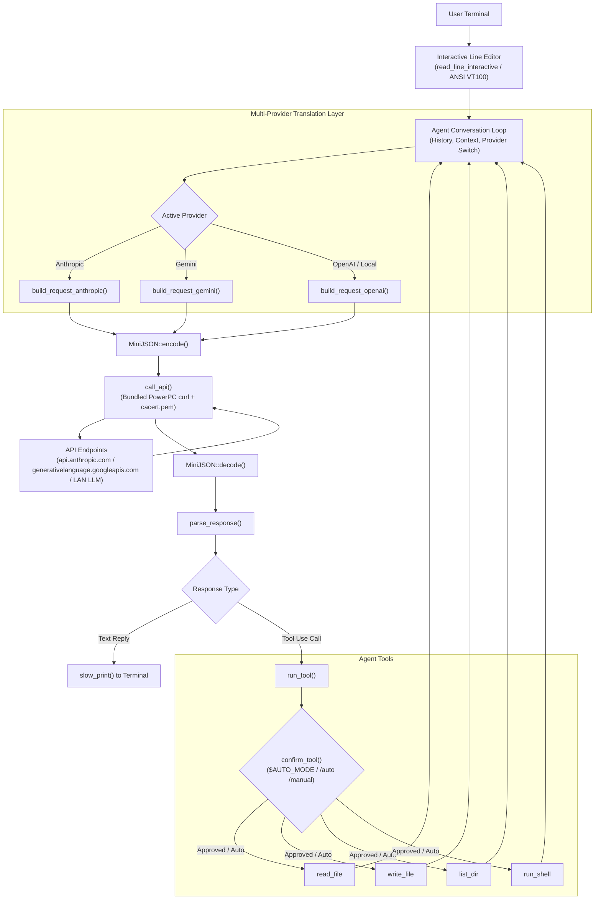

# System Architecture

## High-Level Overview

`ppc-claude-agent` is an interactive CLI coding agent designed to run natively on vintage PowerPC Macs (Mac OS X 10.4 Tiger, Perl 5.8.6). Because Tiger lacks modern TLS 1.2/1.3 ciphers in its native OpenSSL and curl, and does not have modern CPAN toolchains or Python 3, this system operates with zero CPAN dependencies, embeds a custom JSON engine, uses a bundled static `curl` with modern TLS capabilities, and exposes autonomous tool use with explicit user confirmation.

## Subsystems & Layers

### 1. Presentation & Terminal I/O Layer
- **Location**: [`claude-agent.pl`](../claude-agent.pl) (Lines 890–1494)
- **Responsibilities**:
  - Raw terminal management using `stty raw -echo` and `stty cooked`.
  - ANSI / VT100 escape sequence handling (cursor position queries `\e[6n`, arrow keys, home/end, backspace).
  - Terminal size detection via `_probe_terminal_size` and `_query_cursor_pos`.
  - Multibyte UTF-8 input handling avoiding Perl 5.8.6 buffering bugs.
  - History tracking and prompt rendering.

### 2. Multi-Provider & Serialization Layer
- **Location**: [`claude-agent.pl`](../claude-agent.pl) (Lines 52–106, 134–270, 345–640)
- **Responsibilities**:
  - `MiniJSON`: Zero-dependency recursive descent JSON parser and serializer.
  - Provider configurations for **Anthropic** (`claude-sonnet-4-5-20250929`), **Gemini** (`gemini-3.5-flash-lite`), and **OpenAI-compatible** local endpoints (e.g. Ollama, llama.cpp on LAN).
  - Runtime provider switching via slash commands (`/claude`, `/gemini`, `/openai`).
  - Request schema translation between Anthropic's messages/tools format, Gemini's contents/functionDeclarations, and OpenAI's chat/completions format.

### 3. Network Transport Layer
- **Location**: [`claude-agent.pl`](../claude-agent.pl) (Lines 272–344), [`curl`](../curl), [`cacert.pem`](../cacert.pem)
- **Responsibilities**:
  - Execution of `$CLAUDE_CURL` (`/usr/local/claude-toolchain/bin/curl` or bundled `./curl`).
  - Strict certificate verification using bundled Mozilla `cacert.pem`.
  - Payload streaming and response capture via temporary files or pipes.
  - HTTP error code handling and retry guidance.

### 4. Autonomous Tool Execution & Safety Layer
- **Location**: [`claude-agent.pl`](../claude-agent.pl) (Lines 57–60, 1046–1095, 1164–1172, 2040–2080)
- **Responsibilities**:
  - `read_file`: Reads file content in UTF-8.
  - `write_file`: Writes content to local disk with permission checked via `confirm_tool()`.
  - `list_dir`: Scans directory entries excluding `.` and `..`.
  - `run_shell`: Executes arbitrary shell commands via system backticks with permission checked via `confirm_tool()`.
  - `confirm_tool($prompt)`: Permission wrapper that returns `1` immediately when `$AUTO_MODE` is active; delegates to interactive `confirm($prompt)` when manual mode is active.
  - `handle_auto_command($out_fh)` & `handle_manual_command($out_fh)`: Slash command handlers (`/auto`, `/manual`) toggling `$AUTO_MODE`.
  - `get_auto_mode()` & `set_auto_mode($val)`: Encapsulated accessors for `$AUTO_MODE`.

## Data Flow & Lifecycle

1. **User Input**: The user enters a prompt at `User> `. Characters are read one-by-one in raw mode, handling VT100 control codes and UTF-8 multibyte sequences.
2. **Context Assembly**: The prompt is appended to `@messages`.
3. **Request Serialization**: `build_request()` translates `@messages`, available `@TOOLS`, and the `$SYSTEM_PROMPT` into the appropriate provider format and encodes it with `MiniJSON::encode()`.
4. **Transport**: `call_api()` spawns `curl` with `--cacert cacert.pem` to POST the payload to the provider endpoint over TLS 1.2/1.3.
5. **Response Parsing**: The returned JSON is parsed with `MiniJSON::decode()` and normalized by `parse_response()` into text blocks or `tool_use` events.
6. **Execution / Feedback**:
   - If text: Printed to STDOUT using `slow_print()` for a vintage terminal typing effect.
   - If `tool_use`: Dispatched to `run_tool()`. Actions with side effects check `confirm_tool()`, which requires interactive `[y/N]` confirmation in manual mode (`/manual`) or executes immediately in autonomous mode (`/auto`). The tool result is wrapped into a `tool_result` message and re-submitted to the API loop until a final text response is produced.
