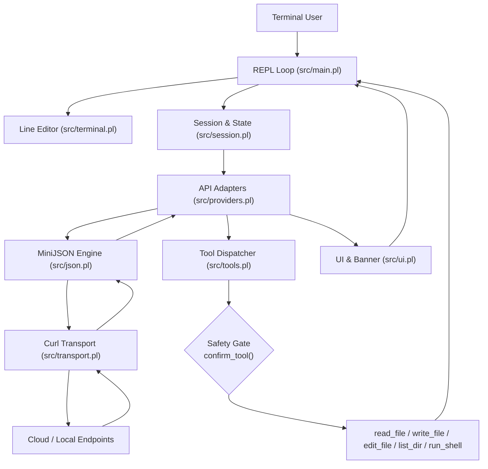

# Architecture & Internals

This page details the internal architecture, operating constraints, and engineering decisions behind `ppc-code-ai-agent`.

---

## 1. Design Constraints for Mac OS X 10.4 Tiger

Vintage PowerPC Macs running OS X 10.4 Tiger (released in 2005) present unique runtime limitations:
1. **Outdated Native TLS**: The system `curl` and OpenSSL libraries only support SSLv3 and TLS 1.0, which all modern AI APIs reject.
2. **Standard Perl 5.8.6**: Perl 5.8.6 is preinstalled, but CPAN is broken or inaccessible due to modern TLS requirements and outdated compilers.
3. **Restricted CPU and RAM**: G3/G4 chips range from 300 MHz to 1.67 GHz with typical memory from 512 MB to 1.5 GB. Inefficient loops or high token serialization memory overhead can freeze the desktop.

### Architectural Solution
* **Zero CPAN Modules**: Built entirely using core standard Perl 5.8.6 built-ins.
* **Prebuilt Bundled Curl**: Uses a self-contained PowerPC binary statically linked against OpenSSL 1.0.2u supporting TLS 1.2 and TLS 1.3 with Mozilla `cacert.pem`.
* **Zero 5.10+ Perl Features**: Strictly avoids defined-or `//`, `state` variables, `say`, named regular expression captures, or smartmatch operators.

---

## 2. Subsystem Layout

---

## 3. Modular Source Tree (`src/`) & Build System

The codebase is split into 10 modular files in `src/` concatenated in a strict manifest order by `build.pl`:

| Order | Module | Core Responsibilities |
| :--- | :--- | :--- |
| 1 | `src/header.pl` | Pragmas, global configuration, color constants, environment loading, `$SYSTEM_PROMPT`. |
| 2 | `src/json.pl` | Pure-Perl `MiniJSON` parser and serializer. |
| 3 | `src/transport.pl` | `call_api` curl execution, shell quotation, certificate handling. |
| 4 | `src/providers.pl` | Request building and response parsing for Anthropic, Gemini, and OpenAI. |
| 5 | `src/models_menu.pl` | Interactive curses-like model selection menu. |
| 6 | `src/session.pl` | Session lifecycle (`init_session`, `archive_session`), slash command dispatchers. |
| 7 | `src/tools.pl` | Tool schemas, permission prompts (`confirm`, `confirm_tool`), `run_tool`. |
| 8 | `src/terminal.pl` | Raw terminal line editor with history and ANSI cursor positioning. |
| 9 | `src/ui.pl` | Two-tone banner (`show_banner`), tool summaries, thinking timers, `slow_print`. |
| 10 | `src/main.pl` | Guarded entrypoint (`unless (caller)`) and main conversation REPL loop. |

### Build System (`build.pl`)
* `perl build.pl`: Concatenates `src/*.pl` into `code-agent.pl`, sets executable permissions (`chmod 0755`), and verifies syntax with `perl -c`.
* `perl build.pl --check`: Compares disk artifact with source tree without modifications (exit 0 if in sync, non-zero otherwise).
* `code-agent.pl` is ignored in Git via `.gitignore`, preserving clean diffs.

---

## 4. `MiniJSON`: Zero-Dependency JSON Engine

To avoid external C dependencies like `JSON::XS` or CPAN's `JSON::PP`, `src/json.pl` implements a recursive descent parser:
* **Encoding**: Transforms Perl hashes, arrays, strings, numbers, booleans, and undef into RFC 8259 JSON.
* **Decoding**: High-performance character-by-character scanner handling string escapes (`\n`, `\t`, `\"`, `\\`, `\/`, `\uXXXX`), nested objects, numbers, and arrays.
* **UTF-8 Handling**: Operates cleanly on decoded text strings, preventing double-encoding artifacts.

---

## 5. Pure-Perl ANSI Terminal Engine

Located in `src/terminal.pl`, this module implements a complete interactive readline engine:
* Puts the terminal into raw mode (`stty raw -echo`) and restores canonical mode on exit.
* Dynamically detects screen size using `TIOCGWINSZ` ioctl with VT100 fallback probes.
* Issues VT100 Device Status Report (DSR `\e[6n`) queries to locate the actual hardware cursor on screen.
* Calculates visual display width using East Asian Width tables for Japanese and CJK character support.
* Preserves command history across session turns.
